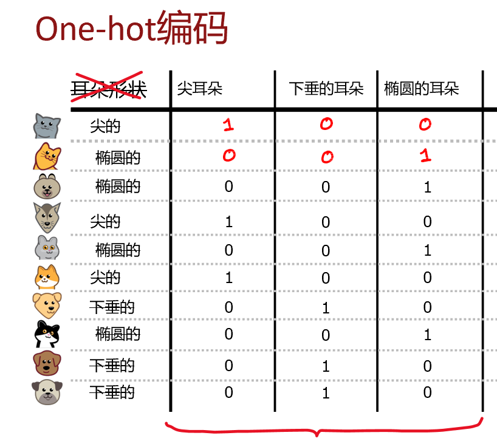

选择节点拆分特征的依据是：哪个特征能最大程度降低熵（降低不纯度、提高纯度）

熵
$H(p_1 )= - p_1  log_2⁡(p_1 ) - (1-p_1 )  log_2⁡(1-p_1)$

熵的降低量被称为信息增益：使用该特征划分前节点的熵，减去划分后左右两支的熵的加权平均
$Information Gain = H(p_1^{root} )-(w^{left} H(p_1^{left} )+w^{right} H(p_1^{right} ))$
## 决策树构建流程

## 独热编码(One-hot编码)

将多值特征转化为二值特征（均为数值型）

将一个具有 k 个离散取值的分类特征，转化为 k 个仅取 0 或 1 的二值特征

## 连续值特征处理

### 阈值拆分
将连续值特征转换成离散的特征

方法：
1.选择多个阈值
2.针对每个候选阈值，计算拆分后的信息增益
3.选择信息增益最大的作为最终拆分依据

候选阈值的选择
1.将所有样本按连续值特征从小到大排序
2.取排序后每两个相邻样本特征值的中点，作为候选阈值
3.若有 10 个训练样本，可得到 9 个候选阈值；遍历所有候选阈值，计算各自的信息增益，最终选择信息增益最大的阈值。

