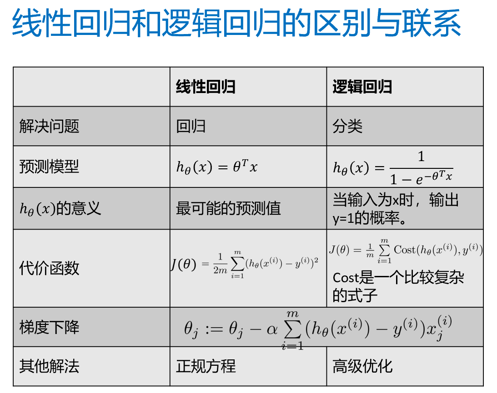
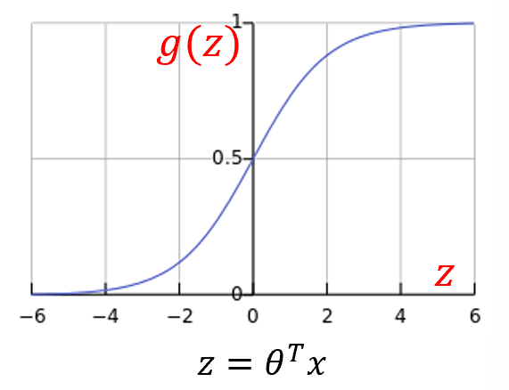
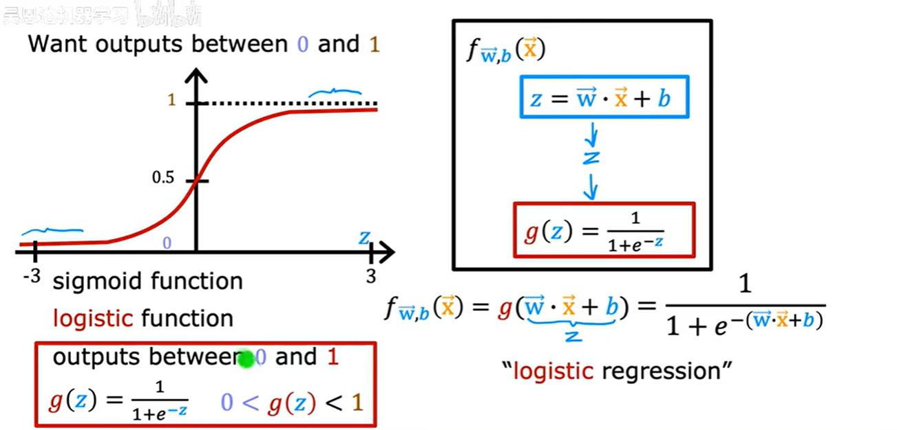
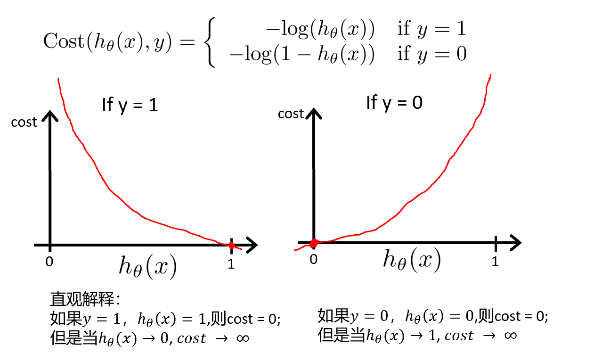
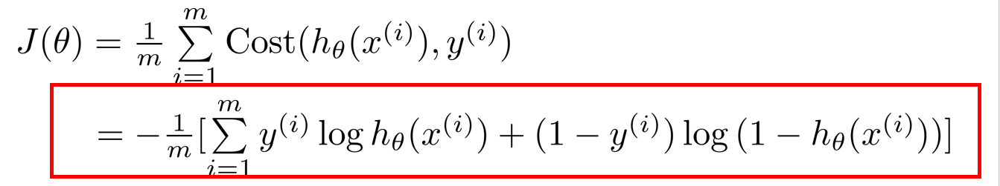
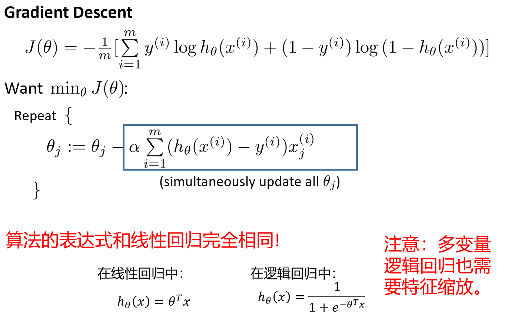

## 逻辑回归 Logistic Regression

## Sigmoid/Logistic 函数
$h_\theta (x) = g(\theta^T x)$
$g(z) = \frac{1}{1 + e^{-z}}$

激活函数

## 损失函数
### 1. 不用MSE损失作为逻辑回归的损失函数
代价函数非凸函数

### 2. 重新定义

**未化简**

y=1时，若 $h_\theta(x) = 1$ 则$cost = 0$
     ……………………$0$   …………无穷
 
### 3. 总结

(1)回归 -> MSE

(2)二分类 -> **二值交叉熵损失** 

## 逻辑回归梯度下降

## 多分类
选输出最大的
输出：属于这个类的概率
所有输出相加不一定为1
